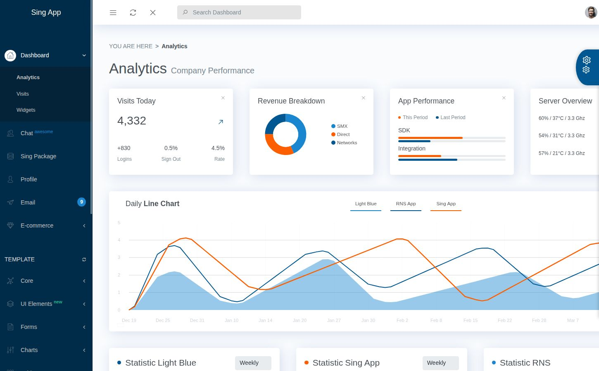

# Sing App HTML5

A Bootstrap 4.6 admin dashboard with 53 HTML pages. Explore the analytics and visits dashboards, interactive D3 charts, editable forms and calendar. The pages use Handlebars layouts and Sass, and run on a static web server.

[Live demo](https://templates.flatlogic.com/sing-app/html5/dashboard/) · [Download the latest release](https://github.com/flatlogic/sing-app-html5/releases/latest) · [Changelog](changelog.md) · [MIT license](LICENSE)

[](https://templates.flatlogic.com/sing-app/html5/dashboard/)

## Run the template

Use Node.js 22.13 or later, Git and Yarn Classic 1.22.22. The example uses Python's static web server for local development.

```sh
git clone https://github.com/flatlogic/sing-app-html5.git
cd sing-app-html5
npx --yes yarn@1.22.22 install --frozen-lockfile
npm run build
python3 -m http.server 8000 --bind 127.0.0.1
```

Open [the local dashboard](http://127.0.0.1:8000/dist/dashboard/index.html). Start the server from the repository root so it can serve the browser libraries next to `dist/`. Run `npm run watch` in a second terminal while editing templates or Sass.

## Find an example

| Example | Template |
| --- | --- |
| Analytics dashboard | [dashboard/index.hbs](src/pages/dashboard/index.hbs) |
| Forms and Markdown editor | [form/form_elements.hbs](src/pages/form/form_elements.hbs) |
| Client-side validation | [form/form_validation.hbs](src/pages/form/form_validation.hbs) |
| Searchable tables | [tables/tables_dynamic.hbs](src/pages/tables/tables_dynamic.hbs) |
| Interactive charts | [charts/charts.hbs](src/pages/charts/charts.hbs) |
| Calendar events | [extra/calendar.hbs](src/pages/extra/calendar.hbs) |

The shared layout and navigation live in [src/partials](src/partials). Edit styles in [src/sass](src/sass) and page behavior in [src/js](src/js). Gulp writes the compiled pages and assets to `dist/`.

## Host the prebuilt demo

Download `sing-app-static.tar.gz` from the release and extract it into a static website directory. Keep `html5/` and `node_modules/` alongside each other. Open `html5/dashboard/` on the web server. The archive includes the browser assets used by the template.

## Support

Use [GitHub Issues](https://github.com/flatlogic/sing-app-html5/issues) for bug reports. Include the affected page, browser version and steps to reproduce.
